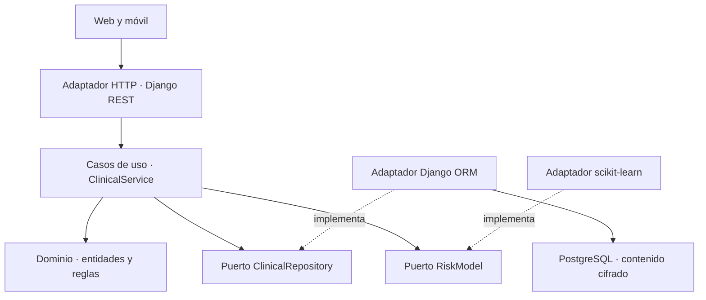

# Arquitectura hexagonal

El dominio y los casos de uso no importan Django, DRF, SQL ni scikit-learn. La aplicación recibe implementaciones de puertos por constructor. Django es un adaptador de entrada HTTP y un adaptador de salida ORM; el adaptador de IA puede sustituirse sin modificar las reglas de expediente.

| Capa | Archivos | Responsabilidad |
|---|---|---|
| Dominio | clinical/domain/entities.py | Actor, paciente, validación, autorización |
| Puertos de salida | clinical/domain/ports.py | Contratos ClinicalRepository y RiskModel |
| Aplicación | clinical/application/services.py | Crear/consultar/editar expedientes, consultas, lecturas, exportación |
| Adaptador de entrada | clinical/adapters/http/ | API DRF, traducción de errores, identidad autenticada |
| Adaptador persistente | clinical/adapters/persistence/ | ORM, cifrado, transacciones, migraciones y auditoría |
| Adaptador IA | clinical/adapters/ml/risk.py | Carga del modelo y predicción; mantiene el contrato de seis variables |
| Composición | clinical/bootstrap.py | Inyección de adaptadores concretos |
| Infraestructura | config/, deploy/, render.yaml | Django, TLS, cookies, CORS, hosting y roles PostgreSQL |
| Identidad | identity/ | Autenticación Django, roles y sesiones móviles revocables |

El puerto de entrada es la interfaz pública de ClinicalService. Los controladores HTTP son delgados para los casos clínicos. El módulo de identidad usa los servicios nativos de Django y no pretende reimplementar contraseñas o sesiones dentro del dominio clínico.

ClinicalRepository.atomic delimita escritura clínica y auditoría en la misma transacción; las lecturas y exportaciones también dejan evento. ChartEntry guarda notas y mediciones como entradas inmutables a través de la API. PostgreSQL revoca UPDATE y DELETE para la cuenta HTTP en estas tablas y en auditoría. El dueño de la base todavía puede modificarlas: esto no es una bitácora criptográfica inmutable.

La web y el móvil comparten el contrato `/api`. El navegador usa sesiones Django y CSRF. Android/iOS usan tokens opacos de 8 horas, guardados como hash en la base y solo en memoria en el cliente. La capa de dominio vuelve a comprobar autorización por expediente aunque el controlador ya esté autenticado.

## Sensores

LiveService depende del puerto LiveRepository y RiskModel. Las reglas puras de validación/conversión están en domain/sensor.py. DjangoLiveRepository implementa transacciones, bloqueo del paciente/sesión, muestras cifradas y credenciales de escritura. El adaptador HTTP ofrece rutas autenticadas de paciente y una ruta de ingestión con token de dispositivo; no inyecta IDs de paciente desde el ESP32. Las muestras y calibraciones quedan separadas de las notas clínicas. El firmware y el cliente BLE son adaptadores externos al dominio.
