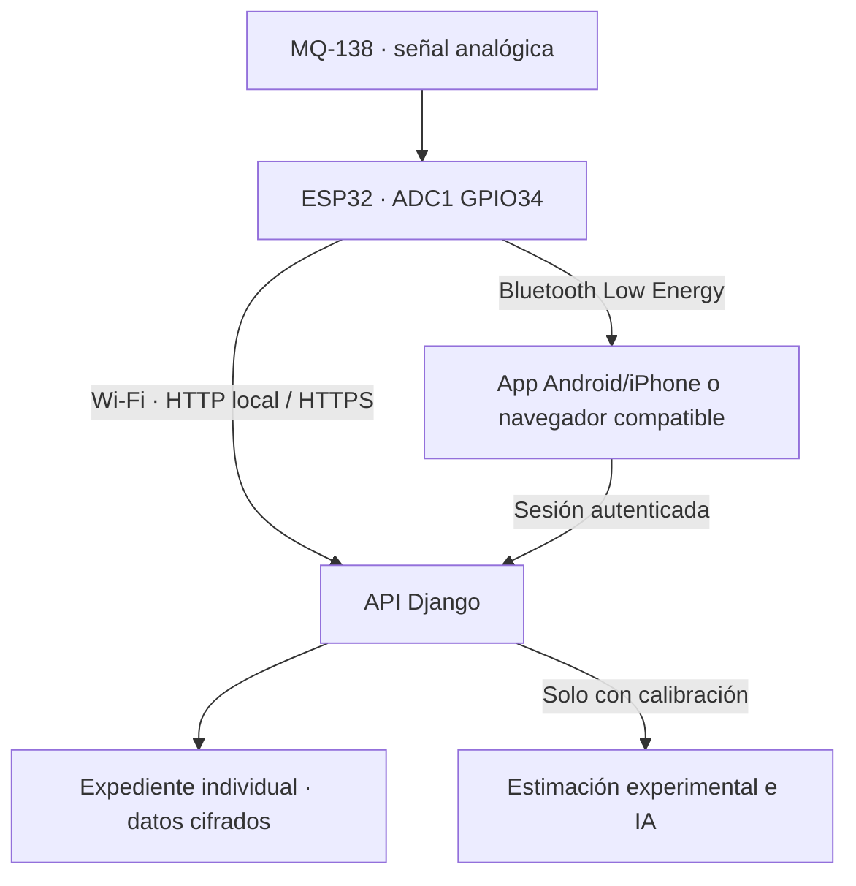

# Prueba en tiempo real con ESP32 y MQ-138

Implementación experimental para ESP32 clásico WROOM/DevKit con BLE (board PlatformIO `esp32dev`). No se supone compatibilidad de GPIO con ESP32-S3/C3, y ESP32-S2 no tiene BLE. Verifica tu variante antes de cablear. No se ha probado el circuito físico del usuario.

## Flujo de datos



Wi-Fi envía directamente al servidor Django, y el teléfono/laptop consulta el estado cada segundo. BLE envía al teléfono/laptop y ese cliente retransmite las muestras a Django. Ambos caminos requieren el servidor accesible para guardar historial; BLE no hace que Django exista dentro del teléfono. No hay base de expedientes offline en la app. La vista puede mostrar el último voltaje recibido por BLE, pero el contador y la gráfica representan las muestras confirmadas por el servidor. Las muestras fallidas no se ponen en una cola durable.

## Conexión eléctrica: módulo MQ-138 con salida AO

Confirma que tu módulo tiene VCC, GND, AO y DO. Una cápsula sin placa requiere el circuito del fabricante y no comparte automáticamente este pinout. Nunca conectes AO de un módulo alimentado a 5 V directamente a un GPIO del ESP32.

| Punto | Conexión de ejemplo |
|---|---|
| MQ-138 VCC | Fuente regulada de 5 V compatible con la placa y el sensor |
| MQ-138 GND | Tierra común con ESP32 |
| MQ-138 AO | Resistencia de 20 kΩ hacia el nodo ADC |
| Nodo ADC | GPIO34 del ESP32 clásico |
| Nodo ADC a GND | Resistencia de 10 kΩ |
| MQ-138 DO | Sin utilizar |
| ESP32 | USB; evita retroalimentar fuentes de 5 V entre sí |

El divisor 20 kΩ/10 kΩ reduce a un tercio el voltaje de AO: 5 V producirían aproximadamente 1.67 V en GPIO34. Mide con multímetro antes de conectar el GPIO. No excedas la tensión permitida por la hoja de datos de la placa y el ESP32. El ADC1 se usa para no depender de ADC2 mientras funciona Wi-Fi.

La resistencia del divisor también carga AO. La RL efectiva y la calibración deben corresponder al montaje COMPLETO; no copies un valor de RL/R0 de otra placa. En montajes de medida se puede requerir un buffer analógico. El software no valida el cableado ni detecta todas las fallas eléctricas.

## Acondicionamiento y calibración

Winsen describe al MQ-138 como sensor de varios VOC y gases, con sensibilidad a tolueno, acetona, alcohol e hidrógeno; no es un medidor selectivo de acetona ni de glucosa. El manual especifica precalentamiento inicial mayor de 48 horas bajo sus condiciones de prueba. La estabilización tras cada encendido depende del protocolo y no reemplaza ese acondicionamiento inicial.

La curva de ejemplo del fabricante no autoriza inventar coeficientes de acetona. Sin calibración se almacenan ADC y mV y se omite ppm/IA. La calibración registrada es una declaración del operador de laboratorio, no una certificación automática de que se realizó correctamente. Requiere referencia conocida y trazable, rango comprobado, montaje y dispositivo exactos.

El administrador pulsa **Calibración** en un expediente y registra:

- Identificador `PoliMQ-…` del dispositivo y referencia/protocolo específicos para acetona.
- R0 y RL efectiva, ambas en kΩ; Vc en mV y factor real del divisor AO/ADC.
- m y b del ajuste `log10(Rs/R0) = m*log10(ppm) + b`.
- Rango mínimo/máximo de la calibración y tiempo de estabilización tras encendido.

El servidor calcula `Rs = RL*(Vc/Vs - 1)` y `ppm = 10^((log10(Rs/R0)-b)/m)` únicamente dentro del rango declarado y después del tiempo de estabilización. Excluye saturación, tensión incompatible y lecturas fuera del rango. El dominio de ppm del modelo se restringe a 0–100; no extrapola a los 500 ppm del rango genérico de catálogo. El CSV original incluye valores inferiores al rango genérico citado para el MQ-138: esa discrepancia requiere validación instrumental y no se resuelve cambiando el código.

Al finalizar, con al menos cinco muestras calibradas válidas, guarda la mediana de las últimas 20 válidas y ejecuta el modelo. Es un resumen de demostración, no un protocolo de análisis de aliento validado. Sin esas condiciones solo guarda la prueba cruda. No genera mediciones clínicas falsas ni recomienda tratamientos.

## Preparar firmware

Carpeta: `firmware/esp32_mq138`. Instala PlatformIO (por ejemplo la extensión oficial en VS Code) y abre esa carpeta.

1. Copia `include/polisalud_config.example.h` como `include/polisalud_config.h`.
2. Completa WIFI_SSID y WIFI_PASSWORD de tu red 2.4 GHz.
3. Para BLE, define un PIN único de 6 dígitos en BLE_PAIR_PIN; cero mantiene BLE deshabilitado. No uses el mismo PIN en todos los equipos.
4. En un despliegue HTTPS configura ROOT_CA_PEM con la CA raíz correcta del servidor. Nunca se llama setInsecure.
5. SOLO para la prueba local HTTP con datos ficticios, cambia ALLOW_LAN_HTTP a true. El firmware solo admite entonces hosts IPv4 privados RFC1918. No expongas este servidor de desarrollo a internet.
6. Compila/carga por USB y abre el monitor serial a 115200 baudios. Se imprime el identificador `PoliMQ-` seguido de la MAC de la placa. No imprime la contraseña de Wi-Fi ni el token del servidor.

Comandos, si PlatformIO está instalado en el entorno de Python:

```powershell
python -m platformio run
python -m platformio run --target upload
python -m platformio device monitor --baud 115200
```

No reinicies el ESP32 entre abrir y terminar una prueba: si la secuencia o uptime retroceden, se requiere una sesión nueva. Los secretos de sesión solo se conservan en RAM del ESP32, nunca se escriben en flash.

## Usar Wi-Fi desde teléfono o laptop

1. Actualiza Django y aplica migraciones/estáticos (ver ACTUALIZAR.md).
2. Con el servidor local ya accesible, entra a `http://192.168.100.28:8000` en el mismo Wi-Fi. Si esa IP cambió, usa la actual. La laptop debe permanecer encendida.
3. El paciente entra a su historial (o el administrador abre el suyo) y pulsa **Prueba ESP32**.
4. Indica el identificador EXACTO del monitor serial, peso, altura y Wi-Fi. Selecciona una calibración del mismo dispositivo o **Solo señal cruda**.
5. Confirma acondicionamiento. Copia el JSON temporal mostrado por la página al monitor serial del ESP32 y envíalo con salto de línea. No contiene datos personales ni credenciales de usuario. La credencial de dispositivo es secreta y se muestra una vez.
6. El ESP32 envía aproximadamente una muestra por segundo. La gráfica muestra voltaje ADC, calidad y muestras confirmadas.
7. Pulsa **Finalizar y guardar resultado**. La prueba aparece en **Pruebas ESP32**; si hubo calibración válida, también queda una medición experimental en el historial.

La configuración de sesión se hace por USB/monitor serial en esta versión. No se implementó una pantalla de provisión Wi-Fi en el ESP32 ni un portal cautivo. Después de provisionar la sesión, la transmisión de datos es inalámbrica.

## Usar Bluetooth LE

No usa Bluetooth clásico/SPP. Se utiliza un servicio GATT y paquetes binarios de 16 bytes.

- App Android/iPhone: incluye @capacitor-community/bluetooth-le 7 y permiso descriptivo de Bluetooth en iOS. Requiere compilar y firmar la app; no hay APK/IPA firmado incluido. Instala dependencias con npm ci y vuelve a preparar/sincronizar usando la URL HTTPS de Django.
- Laptop: Chrome/Edge que expongan navigator.bluetooth en HTTPS o localhost. Firefox no se presupone compatible.
- Web móvil por IP HTTP: Web Bluetooth normalmente no está disponible. Usa Wi-Fi para esa prueba local.
- Safari iPhone: no se ofrece BLE web como solución. Usa la app iOS nativa con el plugin, o Wi-Fi desde Safari.

Pasos: abre **Prueba ESP32**, selecciona BLE e identificador exacto. Pulsa BOOT en la placa DESPUÉS de arrancar para anunciar durante 60 segundos. Pulsa **Conectar ESP32 por BLE**, selecciona el dispositivo y completa el emparejamiento con el PIN configurado, visible localmente en el monitor serial. Se exige enlace BLE cifrado con autenticación. Mantén la app/vista en primer plano. No se implementó lectura en segundo plano ni reconexión automática.

El dispositivo anuncia su identificador, no un nombre de paciente. El código no implementa atestación de hardware; la contraseña de emparejamiento y la credencial de sesión no prueban por sí solas una calibración física ni que la muestra provino de una persona específica. El operador debe confirmar paciente, sesión y dispositivo antes de medir.

## Seguridad y límites operativos

- Token Wi-Fi limitado a una sesión y permiso solo de escritura; vence a los 10 minutos o al finalizar/cancelar. No permite consultar pacientes.
- Muestras con secuencia única, enteros finitos, dispositivo consistente, cadencia aproximada máxima 1 Hz y límite de 300 muestras.
- Una sesión activa por paciente; las muestras y calibraciones son inmutables en la API, con payload cifrado. PostgreSQL restringe UPDATE/DELETE para la cuenta web en esas tablas.
- El historial propio y la señal se consultan solo por su paciente o administrador. Un paciente puede registrar su prueba de sensor, pero no escribir notas clínicas ni capturar una medición manual de otro expediente.
- El polling cada segundo requiere red y servidor despierto. Hosting gratuito con suspensión por inactividad y cuotas no garantiza tiempo real continuo. No es un servicio para emergencias.
- HTTP local y el monitor serial exponen a quien tenga acceso físico/red la configuración; la prueba local es solo con datos ficticios. Para uso remoto se requiere HTTPS y CA validada.

## Fuentes oficiales

- MQ-138: https://www.winsen-sensor.com/sensors/voc-sensor/mq138.html
- Manual: https://www.winsen-sensor.com/d/files/PDF/Semiconductor%20Gas%20Sensor/MQ138%20%28Ver1.4%29%20-%20Manual.pdf
- ADC ESP32: https://docs.espressif.com/projects/arduino-esp32/en/latest/api/adc.html
- BLE móvil: https://github.com/capacitor-community/bluetooth-le/tree/v7
- Web Bluetooth: https://developer.mozilla.org/en-US/docs/Web/API/Web_Bluetooth_API
